<div align="center">


<h3>Proof, not promises: run your coding agent on sealed tasks and get a credential anyone can verify on Solana.</h3>

[](https://github.com/devfellowship/itera-certificacao-onchain/actions/workflows/ci.yml)
[](OPEN-SOURCE.md)
[](https://explorer.solana.com/?cluster=devnet)
[](https://www.typescriptlang.org/)
[](https://www.colosseum.org/)
[](https://itera-agent-credentials.devfellowship.com)
[](https://www.youtube.com/watch?v=5FJsaaEGAPU)
[](https://www.youtube.com/watch?v=dmIhE8XK134)

**[Live app](https://itera-agent-credentials.devfellowship.com)** ·
**[Demo video (2:50)](https://www.youtube.com/watch?v=5FJsaaEGAPU)** ·
**[Pitch video (1:58)](https://www.youtube.com/watch?v=dmIhE8XK134)**
· [Try it in 2 minutes](#try-it-in-2-minutes) · [How it works](#how-it-works) · [Verify a proof](#verify-a-proof-without-trusting-us)

</div>

---

## Why

Every AI coding agent claims to be good. Few of those claims are reproducible. Benchmarks
are self-reported. Demos are cherry-picked. Hidden-test scores live in somebody's spreadsheet.

**TestMyAgent** turns "trust me" into a credential:

- Your agent runs on a **real coding task**, in an **isolated sandbox**, with no internet except the model API.
- A **separate grading container** scores the patch against **hidden tests** that the agent never sees.
- The evidence is **pinned to IPFS**, and its hash is **attested on Solana** with the
  Solana Attestation Service (SAS), as a non-transferable token in the agent owner's wallet.
- **Anyone can verify** the result in the browser, from public data only. The verifier
  ([`apps/web/src/verify.ts`](apps/web/src/verify.ts)) is open source and does not call our server.

The product name is **TestMyAgent**. Some internal identifiers keep the older project name on
purpose: the `ITERA_*` env vars, the `@itera/*` packages, the on-chain Memo prefixes
(`itera-run:v1`, `itera-eval:v1`) and the `itera-agent-credentials*` domains.

## How it works

```mermaid
flowchart LR
    A["🔌 Connect agent<br/>GitHub repo, pinned commit"] --> B["🧩 Pick tasks<br/>catalog or your own"]
    B --> C["💸 Pay with Solana Pay<br/>one signature: transfer + Memo"]
    C --> D["📦 Sandbox run<br/>no internet, model gateway only"]
    D --> E["🧪 Hidden-test grading<br/>separate no-network container"]
    E --> F["📌 IPFS evidence<br/>redacted manifest, SHA-256"]
    F --> G["🏅 SAS attestation<br/>Token-2022, non-transferable"]
    G --> H["✅ Browser verify<br/>public RPC + IPFS only"]
```



1. **Connect an agent.** Install the read-only TestMyAgent GitHub App on a repo, or use a sample
   repo. The agent is pinned to a commit. The runner takes only its `AGENTS.md`, `CLAUDE.md` and `skills/`.
2. **Pick tasks.** Choose curated tasks from the catalog, or tasks that users publish from their
   own repos. The quote itemizes the forecast model cost plus a base fee per run.
3. **Pay with Solana Pay.** The API prices the quote in SOL with Pyth, then builds one transaction:
   a Memo (`itera-eval:v1:` + canonical JSON of the evaluation) and a transfer that carries a
   unique Solana Pay `reference`. The wallet signs once. The API validates the transfer on chain
   before it queues a run.
4. **Sandbox run.** A worker runs the agent (opencode) in a fresh container on a private
   `--internal` Docker network. The only reachable host is a per-run model gateway. The gateway
   holds the model key and enforces a hard cost cap per run.
5. **Hidden-test grading.** The patch is frozen. Then each test suite runs in its own new container
   with `--network none`, a read-only root file system and a different uid. The hidden tests exist
   only in that container.
6. **IPFS evidence.** The grader manifest is redacted (hidden test names removed, counts kept),
   wrapped in an in-toto Statement, hashed with SHA-256 and pinned to IPFS.
7. **SAS attestation.** The API issues a tokenized SAS attestation (`run-result-v2`) to the agent
   owner's wallet. It records `manifest_sha256`, `evidence_cid`, `scenario_id`, `score_total`
   and `run_start_sig` (the payment signature).
8. **Browser verify.** The public proof page (`/e/:slug`) and `/verify` re-check everything from
   the mint address alone.

## Try it in 2 minutes

You need a Solana wallet (for example Phantom or Solflare) set to **devnet**. No real money moves.

1. Open **[the live app](https://itera-agent-credentials.devfellowship.com)** and **connect your
   devnet wallet**. Approve the Sign-In With Solana message.
2. Open the **wallet menu** and click **Get test SOL**. The faucet sends enough devnet SOL to pay
   one evaluation (one grant per wallet per day).
3. Go to **Agents → Add agent** and click **Use sample repo**. You do not need to install the
   GitHub App for the sample.
4. **Choose tasks** for the agent. The quote shows the price per run in USD and in SOL.
5. Click **Pay and start** and sign **once**. Watch the evaluation page: the per-call log streams
   while the agent works, then the state moves to grading and to `issued`.
6. **Open the proof page** of the result and click **Verify in browser**. Each check turns green
   and the page shows **VERIFIED**.

## Verify a proof without trusting us

The verifier needs only an attestation mint address. It reads devnet RPC and the IPFS gateway
directly, and it runs the same in Node and in the browser. It checks that:

- the NFT mint exists, is a Token-2022 mint, is **non-transferable**, and carries token metadata;
- exactly **one holder** holds a balance of 1;
- the SAS **schema** and **credential** are the known TestMyAgent addresses, which are fixed in the
  frontend code, and the credential has an authorized signer;
- the **attestation account** exists, and its address derives from the run-start transaction;
- the **run-start transaction** exists on chain and is confirmed;
- the **pinned evidence hashes** to the `manifest_sha256` that is recorded on chain;
- the evidence names the **same run-start transaction** as the attestation.

A single failed check makes the result `MISMATCH`. The `/verify` page also has a tamper demo: change
the manifest and watch the hash check fail.

## Features

- **Agent registry.** Register agents from GitHub (read-only App, pinned commit) or from sample
  repos. Each agent gets a public page, a ranking position and an embeddable badge.
- **Task catalog.** Curated tasks plus user tasks from GitHub, with a task editor, tags, a tool
  environment and MCP fixture servers (for example a helpdesk API) pinned by image digest.
- **Per-call trace.** Every tool call of the agent is recorded (`run_actions`) and shown live,
  with secrets and absolute paths redacted.
- **Cost control.** The quote forecasts the model cost. The gateway stops a run at a hard
  USD cap. Bring-your-own model key (BYOK) is sealed per run.
- **Public proofs.** Shareable proof pages with Open Graph images, per-mint NFT metadata, badges,
  a leaderboard and public user profiles.
- **Devnet onboarding.** A built-in faucet and sample repos let a fresh wallet finish the full flow.

## Architecture

| Path | What it is | License |
|---|---|---|
| [`apps/web`](apps/web) | Vite + React + TypeScript web app, Solana wallet adapter, SIWS session | Proprietary |
| [`apps/web/src/verify.ts`](apps/web/src/verify.ts) | The public browser verifier for a proof | Apache-2.0 |
| [`apps/api`](apps/api) | Express + TypeScript API: auth, catalog, quotes, Solana Pay, proofs, profiles, faucet | Proprietary |
| [`services/runner`](services/runner) | Worker: runs the agent in a sandbox, then grades it in separate containers | Proprietary |
| [`services/evaluator`](services/evaluator) | Generic verifier: applies the patch, checks scope, computes the score | Proprietary |
| [`services/attestation`](services/attestation) | Solana Attestation Service client (credential, schema, tokenized attestation) | Apache-2.0 |
| [`services/run-issuer`](services/run-issuer) | Run-start transaction issuer | Proprietary |
| [`packages/contracts`](packages/contracts) | JSON Schemas (task, evidence, run profile, run actions) and Ajv validators | Apache-2.0 |
| [`mcp/catalog`](mcp/catalog) | MCP fixture servers (`helpdesk`, `memory`), published to GHCR by digest | Apache-2.0 |
| [`benchmarks`](benchmarks) | Curated tasks: environment, public tests, hidden tests, reference solution | Proprietary |
| [`db/migrations`](db/migrations) | Postgres schema | Proprietary |
| [`docs/architecture`](docs/architecture) | Architecture documents, for example the MCP sandbox contract | Apache-2.0 |
| [`scripts`](scripts), [`tools`](tools) | End-to-end checks, GitHub App setup, design-diff tooling | Proprietary |

The API depends on repository interfaces, never on `pg` directly. Tests inject in-memory fakes,
so the unit test suite needs no database. The runner's security model, with an explicit
"enforced / not enforced" table, is in [`services/runner/README.md`](services/runner/README.md).

## Solana integration

| Primitive | Where | What it does |
|---|---|---|
| **Solana Attestation Service (SAS)** | [`apps/api/src/chain/attestation.ts`](apps/api/src/chain/attestation.ts), [`services/attestation`](services/attestation) | Tokenized attestation `run-result-v2` per run. Token-2022 mint with per-mint metadata, issued to the agent owner's wallet. Idempotent: the same nonce gives the same attestation PDA. |
| **Solana Pay** | [`apps/api/src/evaluations/solana-pay.ts`](apps/api/src/evaluations/solana-pay.ts) | Transfer request with a fresh `reference` per quote. `validateTransfer` on the server before any run is queued. |
| **Pyth** | [`apps/api/src/evaluations/price.ts`](apps/api/src/evaluations/price.ts) | SOL/USD at quote time from the Pyth SOL/USD `PriceUpdateV2` account on Solana (`getAccountInfo`). Prices older than 120 s are refused. Hermes and CoinGecko are fallbacks. |
| **Memo** | [`apps/api/src/evaluations/memo.ts`](apps/api/src/evaluations/memo.ts) | One Memo per payment, `itera-eval:v1:` + canonical JSON (evaluation, runs, agent repo and commit, model, tasks). Its signature is the `run_start_sig` that every proof of the evaluation binds to. |
| **Sign-In With Solana (SIWS)** | [`apps/api/src/http/auth.ts`](apps/api/src/http/auth.ts) | Single-use server nonce (5 min), ed25519 `signMessage`, then a 24 h session token. The wallet address is the user id. |

Everything runs on **devnet** today.

## Trust and anti-collusion

A user can author a task and then run their own agent on it. That cannot be prevented, so the
rules make it worthless ([`apps/api/src/domain/reputation.ts`](apps/api/src/domain/reputation.ts)):

1. **Sealed-test rule.** A task counts for a ranking only when its hidden tests are sealed: a
   curated task, or a user task whose source repo is private. A public-repo task, or a task with
   the `open-tests` label, runs but stays unranked.
2. **Self-evaluated label.** A run is labelled self-evaluated when the task author wallet is the
   agent owner wallet, or when the task repo and the agent repo come from the same GitHub account.
3. **Task reputation.** Each per-task score is weighted by the reputation of the task: distinct
   non-author wallets that ran it, finished runs, and the yes-rate of owner feedback ("the result
   matched reality").

The proof chain itself is bound end to end: the payment Memo names the runs, the attestation
address derives from the payment signature, and the pinned evidence names the same signature.

**Known limits** (also in the runner README): the sandbox is a plain `runc` container, not gVisor
or a VM. The gateway forwards to any model of the provider, not only the quoted model. The hidden
tests of the curated tasks are in this public repository, separated by path and kept out of the
agent sandbox, but readable by anyone who reads the repo.

## Clients: apps/web (web3) and apps/web2 (web2)

Two clients share one API, runner and evaluator. `apps/web` is the web3 client: wallet sign-in, Solana Pay, onchain attestation. `apps/web2` is the web2 client: Login with DFL, free, bring your own OpenRouter key. `apps/web2` has no Solana dependency. Run it with `npm run dev -w @itera/web2` (port 5174).

## Local development

Requirements: Node.js 24 (the version of the Docker images) and npm 11. Docker is needed only for the runner.

```bash
npm ci

# Web app with mock data (MSW fixtures), no API and no wallet needed: http://localhost:5173
VITE_FIXTURE_MODE=design npm run dev -w @itera/web

# Web app against an API of your choice
VITE_API_BASE_URL=http://localhost:3000 npm run dev -w @itera/web

# API (reads DATABASE_URL and the other secrets only when a route needs them)
PORT=3000 npm run dev -w @itera/api
```

The API reads every secret from an env var and fails loud when one is missing (see
`requiredSecret()` in [`apps/api/src/config.ts`](apps/api/src/config.ts)). Main variables:
`DATABASE_URL`, `ITERA_SESSION_SECRET`, `ITERA_HOT_SIGNER_KEYPAIR_PATH` or `_B64`, `PINATA_JWT`,
`GITHUB_APP_*`, `ITERA_RUN_KEY_SECRET` and `ITERA_RUNNER_OPENROUTER_KEY`. Never commit a value.
Login with DFL (web2) reads `DFL_SUPABASE_URL` (default: the DFL project), `DFL_SUPABASE_ANON_KEY`
(the public anon key; without it only `POST /auth/dfl/exchange` answers 503) and `TMA_MIN_IAM_LEVEL`
(default 0).
The free path (DFL principals) has abuse controls: `TMA_RUNS_PER_USER_PER_DAY` (default 10 runs in
24 h, `429 quota_exceeded`), `TMA_MAX_QUEUED_RUNS_PER_USER` (default 3, `429 too_many_queued`), and the
`users.disabled` kill switch (`403 account_disabled` on every write route). SIWS wallets are not affected.

To run one agent on one task on your machine, see "Step 1: local CLI" in
[`services/runner/README.md`](services/runner/README.md).

### Docker images

The root `Dockerfile` builds and serves `apps/web` (`apps/web/server.mjs`: static files, SPA
fallback, and Open Graph tags for `/e/*` link previews). `apps/api/Dockerfile` builds the API and
`services/runner/Dockerfile` builds the worker. All use the repository root as the build context.
When you add a workspace, add its `COPY <workspace>/package.json` line to the Dockerfiles: they run
`npm ci` against the whole lockfile, and CI builds the images, so a missing line fails the PR.

## Tests

```bash
npm run check   # TypeScript in every workspace
npm run test    # unit and integration tests (Vitest and node:test)
npm run build
```

CI ([`.github/workflows/ci.yml`](.github/workflows/ci.yml)) runs on every PR and every push to
`main`: check, test, build, the grader sandbox integration test against real Docker (a probe task
whose hidden tests try to escape), Docker builds of the images, and the MCP catalog conformance
tests.

End-to-end checks against a deployed environment, with a real devnet wallet:

- `npm run e2e:api -- --base <api-url>` drives SIWS, catalog, agent, quote, one signed payment,
  polling to `issued`, the proof, the public profile, badges and the negative paths (401, 402, 403, 404).
- `npm run e2e:browser -- --base <web-url>` drives the web app in Chrome (Playwright) with an
  injected Wallet Standard test wallet. The secret key stays in the Node process. Every page step
  asserts that the root mounts, that there are zero `pageerror` events, and a positive-data control.

Both read the wallet from `E2E_WALLET_SECRET_B58` (base58), accept `--sample` (fresh wallet,
faucet and sample repo) and `--no-pay`, and write a report to `e2e-report/`.

### Deployment

Each app (web, API, runner worker) deploys from `main` on a self-hosted platform. A GitHub webhook
starts the deploy when a push touches the app's watch paths. CI does not gate the deploy, and
GitHub Actions holds no deployment credential.

## Open vs closed

This repository is public, with a mixed license. Details and rules: [`OPEN-SOURCE.md`](OPEN-SOURCE.md).

| Path | License | What it is | Why |
|---|---|---|---|
| `packages/contracts/` | Apache-2.0 | Task, evidence, run-profile and run-actions schemas, tool-environment helpers | Anyone who writes a task or reads a proof needs the contract |
| `apps/web/src/verify.ts` | Apache-2.0 | The browser verifier for a proof | A proof is only trustworthy if anyone can read the checker |
| `services/attestation/` | Apache-2.0 | On-chain attestation client | The proof format must be auditable |
| `mcp/catalog/` (and `mcp/base/`) | Apache-2.0 | MCP fixture servers | Task authors pin these images and need to see them |
| `docs/architecture/` | Apache-2.0 | Architecture documents | Design in public |
| `services/runner/`, `services/evaluator/`, `services/run-issuer/` | Proprietary | Agent runner, grader, proof issuer | Product logic |
| `apps/api/`, `apps/web/` (except the verifier) | Proprietary | API and web app | Product logic and UI |
| `benchmarks/` (hidden tests included), `scripts/`, `db/`, `tools/` | Proprietary | Benchmark tasks and tests, internal tooling | Hidden tests must stay out of reach of agents |

Proprietary means source available for review only: no license to use, copy, modify or distribute.
Apache-2.0 grants for published versions are irrevocable.

## Team

- **Tainan Fidelis**
- **William Rodrigo**

## Acknowledgements

- [Colosseum](https://www.colosseum.org/), for the Crypto World's Fair hackathon.
- [Superteam Solana Brasil](https://br.superteam.fun/), for the community and the support.
- The Solana Foundation teams behind the Solana Attestation Service, Solana Pay and `@solana/kit`,
  and Pyth Network for the price feeds.
