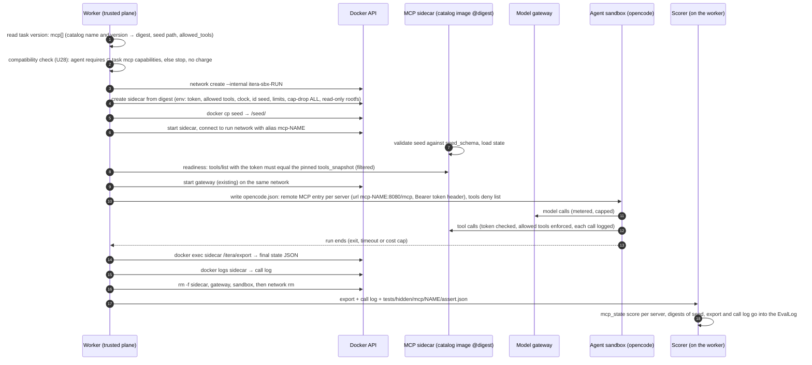

# MCP sandbox — catalog servers, seed, per-run token, state export

Status: **design** (U33, plan [`20261012-itera-testmyagent-ui-refactor`](https://plans.devfellowship.com/20261012-itera-testmyagent-ui-refactor), ADR-11).
Implementation: U28 (contract + compatibility check), U29 (runner sidecars + catalog), U31 (task editor Environment step).

This document answers six questions (Tainan, TG 21019):

1. Do we run the MCP servers of a task inside our environment, with seed data, a final state and a temporary token? **Yes.** Each run gets its own MCP sidecars. Nothing is shared between runs.
2. How does it work? See [Per-run lifecycle](#per-run-lifecycle).
3. When and in which flow is a server registered? See [Registration flow](#registration-flow-catalog-servers).
4. Is anything hardcoded? **No scenario and no server name is hardcoded in the runner.** See [What is hardcoded](#what-is-hardcoded-and-what-is-not).
5. Which repository owns it? See [Ownership](#ownership).
6. Does the monorepo already have something like this? **No.** See [Current state](#current-state).

## Current state

The monorepo has **no MCP code today**. A search for `mcp` and `modelcontextprotocol` over every tracked file (without `node_modules` and the lockfile) on `main` at `f5b59b8` finds no match. No package depends on an MCP SDK.

What exists, and what the MCP sandbox builds on:

| Piece | Where | What it gives the MCP sandbox |
|---|---|---|
| Run profile (Valkyrie-shaped), opencode is the built-in profile | `services/runner/profiles/opencode.json`, `src/run-profile.ts` (#65) | `run_egress`, `secrets` (with `inject_into`), `timeouts`, `resources`. The MCP sidecars are new entries in the same vocabulary. |
| One `--internal` Docker network per run | `services/runner/src/sandbox.ts` `runInSandbox` | The sidecars join this network. No route out. |
| Per-run model gateway | `services/runner/sandbox/model-gateway.mjs` | The pattern to copy: one trusted container per run, holds the secret, the sandbox holds a placeholder, logs read with `docker logs` at the end. |
| Sandbox opencode config | `services/runner/sandbox/opencode.json` | Gets a per-run `mcp` block and a `tools` deny list. |
| Grader sandbox + trusted plane | `services/runner/src/grade.ts`, `docs/contracts/GLOSSARY.md` | Scorers run on the worker, outside every container. MCP state assertions are scorers of the same kind. |
| Validation gate (ADR-8) | `services/evaluator/src/validate.ts` | Gets MCP checks (see [Validation gate](#validation-gate)). |
| Task contract | `packages/contracts/schemas/task.schema.json` | `environment` today holds `dir`, `install`, `allow_internet`. ADR-11 adds `tools` and the MCP list there. |

## Model

There are three parts. Keep them separate:

| Part | What it is | Who writes it | Where it lives |
|---|---|---|---|
| **Catalog MCP server** | A *fixture server* image that we own: the MCP tools, a seed loader, a state export, per-run token auth. It simulates a service (a help desk, a ledger, a knowledge graph). It never calls a real service. | Itera maintainers | Monorepo `mcp/catalog/<name>/` → image by digest |
| **Scenario** | Seed data + scorer assertions for one task. The same server serves many scenarios. | The task author | The **task** repo (or `benchmarks/<task>/` for our own tasks) |
| **Run wiring** | Boot, token, opencode config, export, destroy. Generic. Knows no server name. | Itera maintainers | `services/runner` |

### The fixture-server contract

Every catalog image implements the same contract. The runner depends only on this contract.

| Surface | Contract |
|---|---|
| MCP endpoint | Streamable HTTP on port `8080`, path `/mcp`. A server that speaks only stdio is wrapped by our base image, which bridges stdio to HTTP **inside the sidecar**. The agent sandbox never spawns an MCP process. |
| Auth | Every request must carry `Authorization: Bearer <ITERA_MCP_TOKEN>`. Any other value gets `401`. The token comes in as an environment variable at `docker create`. |
| Allowed tools | `ITERA_MCP_ALLOWED_TOOLS` (comma list). The server hides every other tool in `tools/list` and answers a call to it with a JSON-RPC error. **This is the enforcement.** The opencode `tools` deny list is a convenience only, because the agent can edit its own config or call the endpoint with `curl`. |
| Seed | The worker copies the seed to `/seed/` with `docker cp` before start. At start the server validates it against the `seed_schema` of its manifest and loads it. An invalid seed stops the server (exit code `3`), and the run ends `error` before the agent starts. |
| Call log | One JSON line per tool call on stdout: `seq`, `tool`, arguments digest, `ok`, timestamp. The worker reads it with `docker logs`, as it does for the model gateway. |
| State export | A command in the image, `/itera/export`, that prints the final state as JSON on stdout. The worker runs it with `docker exec`. **It is not a network endpoint.** Only the holder of the Docker API (the worker, the trusted plane) can run it. |
| Determinism | Fixed clock (`ITERA_MCP_CLOCK`), fixed id seed (`ITERA_MCP_ID_SEED`), no randomness that is not seeded. The same seed plus the same calls gives the same export, byte for byte. |
| Egress | None. The image must work with no network other than the run network. |

### Scenarios live in the task, not in the runner

`task.json` declares the servers in `environment.tools.mcp[]` (ADR-11). The runner reads that list and nothing else.

```json
"environment": {
  "dir": "environment",
  "allow_internet": false,
  "tools": {
    "builtin": ["read", "edit", "bash", "search"],
    "mcp": [
      {
        "name": "helpdesk",
        "catalog": "helpdesk@1",
        "transport": "http",
        "seed": "mcp/helpdesk/seed.json",
        "allowed_tools": ["search_tickets", "get_customer", "issue_refund", "close_ticket"],
        "expose_state_to_scorer": true
      }
    ]
  }
}
```

The task bundle layout for one server:

```text
<task>/
  task.json
  instruction.md
  environment/                       copied into the agent workspace
  mcp/helpdesk/seed.json             initial state; NOT copied into the workspace
  tests/hidden/mcp/helpdesk/assert.json   scorer assertions; grading side only
  solution/mcp-calls.jsonl           the reference tool-call sequence (validation gate)
```

⚠️ **The seed is NOT under `environment/`.** The U33 brief wrote `environment/mcp/<name>/seed.*`. That path is wrong: the runner copies all of `environment/` into the agent workspace, so the agent would read the seed (and with it, the scenario) from disk. The seed goes in `mcp/<name>/` at the task root. The agent learns the state only through the tools, which is the skill under test.

The assertions are **declarative JSON**, evaluated on the worker (trusted side), for example:

```json
[
  { "path": "$.tickets[?(@.id=='T-104')].status", "equals": "closed" },
  { "path": "$.refunds.length", "equals": 1 },
  { "calls": "issue_refund", "max": 1 }
]
```

Why not a vitest file in the grading container: the grading container runs the agent's patched code in the same process as the tests, so that code can change what the test reads ("Grader sandbox", `services/runner/README.md`). The MCP state never enters a container that runs agent code. A new scorer, `mcp_state`, reads the export and the call log and gives one `Score` per server.

## Registration flow (catalog servers)

**Who:** an Itera maintainer. **Where:** the monorepo `devfellowship/itera-certificacao-onchain`, path `mcp/catalog/<name>/`. **How:** one PR. Nobody registers a catalog server through the API or the UI.

The directory holds:

| File | Content |
|---|---|
| `manifest.json` | `name`, `version` (integer, immutable once published), `description`, `transport`, `resources` (cpus, memory_mb, pids), `seed_schema` (JSON Schema), `export_schema`, `license`, `upstream` (repo + commit, for an adapted community server), `capabilities` (tags that an agent's `requires` can name). |
| `tools.json` | The `tools/list` snapshot: every tool name, description and input schema. Reviewed in the PR like code. |
| `Dockerfile` + source | Built `FROM` our fixture base image. |
| `fixtures/` | At least one seed and its expected export, for the conformance test. |

Steps:

1. **PR** adds `mcp/catalog/<name>/`. A code owner reviews the tools, the seed schema and the license.
2. **CI job `mcp-catalog`** (new, in `.github/workflows/ci.yml`, GitHub-hosted because the repo is public) builds every changed image and runs the conformance test against it: boot with a fixture seed, `401` without a token, `tools/list` equals `tools.json`, a disallowed tool is refused, the export equals the expected export, two runs give the same export, the container works on `--network none` plus the run network only.
3. **On merge to `main`**, the same job pushes `ghcr.io/devfellowship/itera-mcp-<name>:<version>` and records the **digest**. It refuses to push a version tag that already exists, so a version never changes after it is published.
4. **The API syncs** (on deploy and on a timer): it reads `mcp/catalog/*/manifest.json` and `tools.json` at the deployed commit, resolves each `<name>:<version>` to its digest in GHCR, and upserts one row per version in the table `mcp_catalog` (`name`, `version`, `image_digest`, `tools_snapshot`, `manifest`, `commit`, `status`). New migration, number taken at implementation time (the next free one after `0009_user_tasks`). Grants to `itera_api_service` in the same file, RLS on, no policies, no DB function.
5. **A task pins** `<name>@<version>`. The task version stores the resolved digest and the `tools_snapshot`. The public task page (U30) shows that snapshot. A later catalog version does not change an existing task version.

### Custom MCP server from a task repo

A user task can ship its own server in its repo (`mcp/<name>/Dockerfile` + `manifest.json` + `tools.json`).

1. The API reads it through the GitHub App **at the pinned commit** of the task version (same rule as the rest of a user task).
2. The server is stored with status `pending_review`. **No build, no probe and no run happen before approval.** The task cannot pass the validation gate, and the quote (U28) marks it not runnable.
3. A reviewer (Itera staff) reads the Dockerfile, the source and `tools.json`, then approves.
4. After approval, the image is built from that commit in the builder (no secrets, no Docker socket of the worker host, network only to package registries), and stored in a private GHCR package by digest. A new commit means a new review.
5. From there it is the same as a catalog server: same contract, same conformance test, same lifecycle.

## Per-run lifecycle



Notes:

- **Token.** The worker generates 32 random bytes per run and per server. The token lives only in the sidecar environment and in the sandbox `opencode.json`. It dies with the sidecar. The agent can read it, and that is acceptable: it opens only this run's fixture, which holds only seed data.
- **Readiness** uses the same `tools/list` the agent sees, so a server that boots with the wrong tools stops the run before any model call.
- **Cleanup** joins the existing `cleanup` list in `runInSandbox` and the orphan sweep in `src/orphans.ts` (label `itera.role=mcp-sidecar`).
- **Evidence.** The EvalLog records, per server: catalog name, version, image digest, seed sha256, export sha256, call count. The raw export stays private, like hidden tests.
- **Trace.** opencode reports MCP calls as `tool_use` events with tool `<server>_<tool>`. They become actions, as built-in tools do today.

## Validation gate

The ADR-8 gate (`validateTask`) gets one more check, `mcp`, for a task that declares servers. All steps must pass:

1. Each server resolves to an **approved** catalog version or an approved custom server, with a digest.
2. Each seed validates against the server's `seed_schema`.
3. Each `allowed_tools` entry is in the pinned `tools_snapshot`.
4. **Baseline:** boot with the seed, run no calls, export. The `mcp_state` assertions **fail** (at least one), so the task is not already solved.
5. **Solution:** boot with the seed, replay `solution/mcp-calls.jsonl`, export. Every assertion **passes**.
6. **Repeatable:** step 5 three times gives the same export sha256.
7. **Time:** boot to ready inside the server's `boot_timeout`, and each replayed call inside its `call_timeout`.

The result has counts only, never assertion text, as today.

## Threat model

| Threat | Control |
|---|---|
| The agent reads the final state, or the assertions, to game the scorer | The export is a `docker exec` command, not a port. The assertions are under `tests/hidden/`, which never enters the agent sandbox. The seed is outside `environment/`. |
| The agent calls a tool that the task did not allow | The sidecar enforces `ITERA_MCP_ALLOWED_TOOLS`. The opencode deny list is not trusted. |
| The agent uses the sidecar to reach the internet | The sidecar is only on the `--internal` run network. A conformance test runs every catalog image with no other network. |
| Run A reaches the sidecar of run B | One network and one token per run. The sidecar is never on a shared network. |
| The agent changes the sidecar state outside the tools | The agent has no Docker API and no shell in the sidecar. Read-only root filesystem, state in a `tmpfs`. |
| The sidecar exhausts the host | `--memory` (no swap), `--cpus`, `--pids-limit`, `--ulimit nofile`, `--cap-drop ALL`, `no-new-privileges`, non-root uid, wall limit = run wall limit. Values come from the manifest, capped by worker env limits. |
| A real secret leaks through a fixture | Catalog servers get no secret. They simulate services. `environment.secrets` in a task holds names only, and a task with an MCP server that needs a real third-party credential is refused by the gate. |
| A hostile custom server image | No build before human review. Built from the pinned commit. Same sidecar posture as a catalog image. Its export is data: the scorer parses it as JSON with a size limit and never runs it. |
| A hostile export (huge or malformed) | Size limit on `docker exec` output (same idea as `MAX_REPORT_BYTES` in `grade.ts`). Malformed JSON → the `mcp_state` score is unscored (`value: null`), never zero. |
| Kernel or runtime escape | **Not covered.** Plain `runc`, as for the sandbox and the grader. |

## What is hardcoded, and what is not

| Hardcoded in the runner (generic contract) | NOT hardcoded (data) |
|---|---|
| Port `8080`, path `/mcp`, header name, env var names, `/itera/export`, the alias pattern `mcp-<name>`, label `itera.role=mcp-sidecar` | Server names, images, digests, tools — in `mcp_catalog` |
| The lifecycle steps above | Seeds, assertions, allowed tools — in the task repo at a pinned commit |
| | Resource limits — in each manifest, capped by worker env |

## Ownership

| What | Repository | Path |
|---|---|---|
| Fixture base image, catalog servers, conformance test | `devfellowship/itera-certificacao-onchain` | `mcp/base/`, `mcp/catalog/<name>/` |
| CI build, test and publish | same | `.github/workflows/ci.yml`, job `mcp-catalog` |
| Catalog table + sync | same | `db/migrations/00NN_mcp_catalog.sql`, `apps/api` |
| Sidecar lifecycle | same | `services/runner/src/` (new `mcp-sidecar.ts`) |
| `mcp_state` scorer, gate check | same | `services/evaluator/src/` |
| `environment.tools` schema | same | `packages/contracts/schemas/task.schema.json` (U28) |
| Scenarios (seed + assertions + replay) | each **task** repo; our own tasks in `benchmarks/<task>/` | `mcp/<name>/`, `tests/hidden/mcp/<name>/`, `solution/mcp-calls.jsonl` |
| Custom servers | the task repo, reviewed by Itera | `mcp/<name>/` |

## Community reuse

Checked from source on 2026-10-12 (GitHub API: license file, `archived`, last push / last commit on the path).

| Server | Source | License | Status | Use as a fixture? |
|---|---|---|---|---|
| **memory** (knowledge graph) | `modelcontextprotocol/servers` `src/memory` | MIT → Apache-2.0 transition (see note) | Maintained; last commit on the path 2026-10-10 | **Yes.** State is one JSONL file (`MEMORY_FILE_PATH`): seed = JSONL, export = read the file. No egress. 9 tools (`create_entities`, `read_graph`, `search_nodes`, …). |
| **everything** | same, `src/everything` | same | Maintained (2026-10-10) | **CI only.** A protocol test server. Use it in the conformance test of the base image, not as a task server. |
| **filesystem** | same, `src/filesystem` | same | Maintained (2026-10-10) | **No for now.** It duplicates the built-in read/edit tools. |
| **git** | same, `src/git` (Python) | same | Maintained (2026-10-10) | **No for now.** It duplicates `bash` + git in the workspace. |
| **fetch** | same, `src/fetch` (Python) | same | Maintained (2026-10-10) | **No.** Its purpose is internet egress. |
| **time**, **sequentialthinking** | same | same | Maintained | **No.** No state to score. |
| postgres, sqlite, github, gitlab, slack, redis, puppeteer, gdrive, … | `modelcontextprotocol/servers-archived` | MIT | **Archived** (read-only since 2025-05) | **No.** Unmaintained. |
| GitHub MCP server | `github/github-mcp-server` | MIT | Maintained (v2.0.2, 2026-10-08) | **Not as a fixture.** It talks to the real GitHub API. Usable only behind a fake GitHub API, which we would have to build. Later. |
| Playwright MCP | `microsoft/playwright-mcp` | Apache-2.0 | Maintained (2026-10-08) | **Later.** It needs a browser and a target site inside the run network. |
| Supabase MCP | `supabase/mcp` | Apache-2.0 | Maintained | **No.** It manages a real Supabase project. |
| Notion MCP | `makenotion/notion-mcp-server` | MIT | Maintained (2026-09-20) | **No.** Real Notion API. |
| TypeScript SDK | `modelcontextprotocol/typescript-sdk` | MIT → Apache-2.0 transition | Maintained (v2.3.1, 2026-10-05) | **Yes, as a library** for the base image and our own fixture servers. |
| τ-bench / τ²-bench (scenario design, not MCP) | `sierra-research/tau-bench`, `sierra-research/tau2-bench` | MIT | tau2 maintained (2026-10-07) | **Ideas only.** Its domains (retail, airline: database + policy + tools + final-state check) are the model for our own fixture servers. |

**License note.** The `LICENSE` file of `modelcontextprotocol/servers` and of the TypeScript SDK says: the project moves from MIT to Apache-2.0. New contributions are Apache-2.0. Old contributions without relicensing consent stay MIT. Both are permissive. An image that contains this code ships both license texts and the upstream commit in `manifest.json` `upstream`.

The repo README also says that its servers are **reference implementations, not production-ready**. That is acceptable for a fixture: the sidecar runs with seed data, in an isolated network, for one run.

### The first two catalog servers

1. **`memory`** — adapted from the reference server at a pinned commit. Lowest risk: the state is already one file, so seed and export need almost no code. It proves the full lifecycle end to end.
2. **`helpdesk`** — our own server, built on the TypeScript SDK, in the τ-bench style: customers, orders, tickets, a refund policy. Tools: `search_tickets`, `get_customer`, `get_order`, `issue_refund`, `close_ticket`, `add_note`. It gives scenarios where the final state shows whether the agent followed the policy (one refund, the correct amount, the ticket closed), which is what an `mcp_state` scorer is for.
